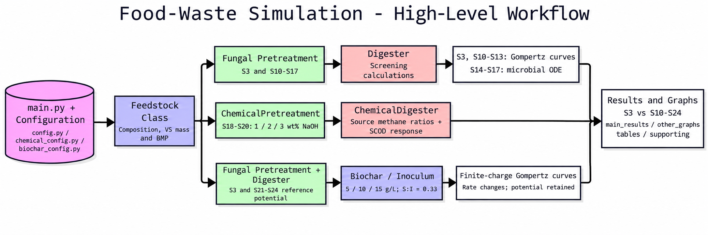

# Food-Waste Anaerobic-Digestion Simulation

**Project guide and handover — S3 and S10–S24**

## Start with the methane results

- [Main methane-yield comparison](output/main_results/01_MAIN_methane_yield_S3_S10-S24.png)
- [Combined results table](output/main_results/scenario_summary.csv)
- Run from this folder: `python main.py`

This README contains setup and handover instructions, the file map, software checks and limitations. The scenario definitions, results and detailed development notes are in [S10–S24 Finalisation](S10-S24_FINALISATION.md).

## Contents

- [Handover and operating guide](#handover-and-operating-guide)
- [Scenario definitions and results](S10-S24_FINALISATION.md)
- [Original project background](#original-project-background)

## Handover and operating guide


## Status and scope

This handover contains the local pretreatment-based simulation with the team's S10–S17 work, Vanpraseth Tuy's S18–S20 NaOH implementation, and the S21–S24 biochar/inoculum work integrated from teammate branch `biochar-inoculum` (tip `1add31c`). The starting pretreatment commit is `6aa1dc6`; the NaOH source commit is `fae8ad3`.

The combined implementation is a local working snapshot. It has not been committed or pushed as part of this handover, and the GitHub PR has not been merged. Do not assume cloning GitHub reproduces this snapshot.

Software integration is complete for the stated scope. Predictions remain subject to the limitations below; this is not a claim of experimental validation or readiness for plant operation.

## Start here

Read [S10–S24 Finalisation](S10-S24_FINALISATION.md) for the consolidated scenario definitions, results and historical notes.

1. Open [the main comparison graph](output/main_results/01_MAIN_methane_yield_S3_S10-S24.png).
2. Review [the combined results CSV](output/main_results/scenario_summary.csv).
3. For biochar/inoculum effects over time, open [the separate cumulative comparison](output/other_graphs/biochar_inoculum_gompertz_curve.png).

The main comparison includes **S3 and S10–S24**. S1–S9 are still calculated internally, including S3 calibration, but the main exported table selects the extended scenarios and S3.

## Installation and running

Use Python 3.12. The handover was checked with Python 3.12.7. Open a terminal in this project's root folder (the folder containing `main.py`).

macOS / Linux:

```bash
python3 -m venv .venv
source .venv/bin/activate
python -m pip install -r requirements.txt
python main.py
```

Windows PowerShell:

```powershell
py -3.12 -m venv .venv
.\.venv\Scripts\Activate.ps1
python -m pip install -r requirements.txt
python main.py
```

For an environment matching the checked library versions, install `requirements-handover.txt` instead of `requirements.txt`. The original requirements are retained.

Run the complete file `main.py`, rather than a selected text fragment or `tempCodeRunnerFile.py`. The latter is an older editor-generated copy and is excluded from the handover package. Run each simulation in a fresh Python process. Outputs use paths relative to the current terminal folder, so always run from the project root. Rerunning overwrites the generated results at the same paths.

## Scenario definitions

| Scenarios | Change being investigated | Implementation |
|---|---|---|
| S3 | 60 U/g VS fungal enzyme dose; 24-hour pretreatment | Fungal comparison reference |
| S10–S13 | Cooked rice, meat waste, plant oil and banana-peel feed profiles | Existing composition screening calculations |
| S14–S17 | +20% activity parameter for acidogenic, acetogenic, acetoclastic and hydrogenotrophic groups respectively | Existing simplified ODE pathway; initial biomass calibrated to S3 |
| S18–S20 | 1, 2 and 3 wt% NaOH per wet food-waste mass | NaOH replaces fungal pretreatment |
| S21–S23 | 5, 10 and 15 g/L biochar | S3 fungal treatment retained; exploratory rate response |
| S24 | Substrate-to-inoculum ratio 0.33 g VS/g VS, versus S3 ratio 1 | S3 fungal treatment retained; exploratory inoculum-capacity response |

The standard extended cases use a 25-day duration and a scenario nominal OLR of 2.5 kg VS/m³/day. The feed input is 10 kg wet waste with TS fraction 0.25 and VS/TS fraction 0.90, equivalent to 2.25 kg VS. The difference between this mass and the nominal loading is retained and disclosed below.

NaOH inputs record 24-hour pretreatment, 4°C and post-treatment pH 6.2 ±0.1. These chemical conditions are metadata/settings, not a dynamic neutralisation-reaction simulation. At 10 kg wet feed, NaOH doses are 0.1, 0.2 and 0.3 kg respectively.

## Code and configuration map

| File | Role |
|---|---|
| `main.py` | Scenario list, orchestration, S3 biomass calibration, output selection and generation |
| `data/config.py` | Feed profiles, fungal parameters, BMP constants, digestion settings, risk/stability and microbial parameters |
| `data/chemical_config.py` | NaOH inputs, fitted SCOD coefficients and source benchmark data |
| `data/biochar_config.py` | Biochar assumptions and inoculum sensitivity settings; scenario definitions are in `main.py` |
| `AD/feedstock.py` — `Feedstock` | Feed composition, VS mass and inoculum-mass calculation |
| `pretreatment/pretreatment.py` — `Pretreatment` | Fungal pretreatment response |
| `pretreatment/chemical_pretreatment.py` — `ChemicalPretreatment` | NaOH response and source treatment ratios |
| `AD/digester.py` — `Digester` | Yield, kinetics, simplified microbial ODE, energy and stability calculations |
| `AD/chemical_digester.py` — `ChemicalDigester` | NaOH-specific extension |
| `AD/biochar_inoculum.py` | Exploratory finite-charge Gompertz calculations |
| `utils/` | Graphs, parameter checks and sensitivity exports |

The project is a simplified scenario model with different calculation pathways. It is **not a complete implementation of standard dynamic ADM1**, despite the repository name.

## Output folders

- `output/main_results/`: the main methane-yield graph and the combined scenario table.
- `output/other_graphs/`: other combined charts and scenario-group comparisons, including biochar/inoculum Day-10, Day-15 and Day-25 plots.
- `output/tables/`: detailed biochar/inoculum and presentation summaries.
- `output/supporting/`: daily time series, parameter assumptions and sensitivity results.

### Main reported screening results

| Scenario | Reported screening yield* | Change vs S3 |
|---|---:|---:|
| S3 | 285.053 | Reference |
| S10 | 231.587 | −18.76% |
| S11 | 261.056 | −8.42% |
| S12 | 531.768 | +86.55% |
| S13 | 199.986 | −29.84% |
| S14 | 285.104 | +0.02% |
| S15 | 285.243 | +0.07% |
| S16 | 317.586 | +11.41% |
| S17 | 317.603 | +11.42% |
| S18 | 274.711 | −3.63% |
| S19 | 287.430 | +0.83% |
| S20 | 303.364 | +6.42% |
| S21–S24, each | 285.053 | 0.00% |

*The inherited CSV label is `Specific Yield (L/kgVS)`. This is a stability-adjusted project screening metric using the numerical nominal-loading denominator, not normalisation by actual substrate VS mass. Do not present it as a validated physical specific yield.

Changes in this table use `100 × (scenario screening yield / S3 screening yield − 1)`, based on the exported values before display rounding. The CSV's `Improvement (%)` field has a different untreated-control baseline and must not be substituted for change vs S3.

S12 has the highest reported screening value overall; S20 has the highest among the three NaOH cases. These identify candidates for further assessment, not confirmed operational optima.

### Reading the S21–S24 results correctly

The main screening metric is unchanged because these cases retain the same assumed ultimate potential and stability as S3. Their response changes the conversion rate, so differences appear in the separate finite-time tables and curves.

The biochar/inoculum CSVs distinguish cumulative volume (Nm³), actual-substrate-mass batch yields and legacy nominal-loading metrics. Compare the same column and the same day against S3. Do not mix these metrics into one ranking.

The biochar/inoculum cumulative comparison uses origin-normalised, stability-adjusted finite-charge curves. The general combined curve chart retains the original S3/composition/chemical curves and the S14–S17 ODE curves. Their conventions differ; use the dedicated S21–S24 graph for controlled rate comparisons.

## Software verification

The optional S21–S24 automated test suite and its reference fixtures were removed at the user's request. They were not required by `main.py`. This delivery does not include an automated test suite.

Before removal, the focused suite passed 30 tests. That is historical verification, not a test command available in this delivery or evidence of experimental validation.

The simulation was rerun after removal and the combined CSV was compared with the preceding saved results. S3 and S10–S24 values were unchanged.

## Important limitations and remaining review

1. **Validation:** no project-specific experimental validation was established by this handover. Literature-based inputs, fitted coefficients and assumed parameters have different evidence strengths.
2. **Units:** nominal OLR 2.5 differs from the actual 2.25 kg VS feed basis. Some volume/energy headers inherit daily-rate wording although batch/curve quantities also exist. Check the calculation and time basis before using outputs for engineering or economics.
3. **NaOH:** the final methane response uses source treated/control methane ratios through biodegradable fractions, not a purely mechanistic SCOD-to-methane pathway. SCOD coefficients are fitted estimates. Hydrolysis enhancement is disabled (`beta_chem=0`), and no separate dynamic sodium-inhibition calculation is applied. Stored sodium parameters are not evidence that inhibition is simulated. Source experimental conditions differ from project conditions.
4. **Fungal plus chemical treatment:** S18–S20 currently replace fungal pretreatment. They do not implement the combined fungal-plus-NaOH treatment discussed with Dr Bita.
5. **Biochar/inoculum:** rate-response parameters are exploratory and uncalibrated. Ultimate potential is held fixed. Working-volume feasibility, endogenous inoculum gas and material-specific inhibition are not established.
6. **Microbial pathway:** existing S14–S17 code modifies the shared microbial parameter dictionary in place. Later cases can inherit earlier changes, so these are not assured independent one-factor microbial experiments. Repeated `main()` calls in one Python session can compound changes. Fresh-process runs reproduce the delivered sequence but do not resolve this limitation.
7. **Derived S14–S17 fields:** ODE methane replaces the initially calculated treated methane after object construction. Energy and untreated-control improvement fields are not all recalculated after this replacement. Use the ODE curve and the subsequently computed practical screening result for those scenarios; derived energy/improvement values require review.
8. **Version control:** the working snapshot contains uncommitted additions, edits and moved outputs. The ZIP captures this local state; it is not a new tagged GitHub release.

No scientific calculation was changed to conceal these limitations during handover preparation.

## Suggested next steps for the receiving team

- Confirm the intended model scope and whether fungal treatment must also be retained in chemical scenarios.
- Review the microbial shared-parameter behaviour, derived outputs and yield normalisation before scientific conclusions are finalised.
- Calibrate assumed treatment/rate relationships using suitable data, then validate against separate measurements.
- Evaluate treatment costs, neutralisation, material availability, sodium effects and physical reactor-volume constraints before operational recommendations.
- After team review, approve a version-control commit/release separately.

The source references remain in `data/chemical_config.py`; the historical scenario notes are preserved in the appendices of `S10-S24_FINALISATION.md`. Older scientific wording and historical test counts in those notes should be read alongside this current handover guide.

## Handover contents and exclusions

The accompanying ZIP includes source code, configuration/data files, documentation, graphs and results. It excludes `.git`, virtual environments, caches, editor temporary runner files and operating-system metadata. No message or package has been sent to Dr Bita automatically.

---

## Original project background

<details>
<summary>Expand the original project description and diagrams</summary>

The original description is retained for context; use the current instructions and limitations above for the delivered snapshot.

**Project: Waste-to-Energy Simulation: Biogas Production from Food Waste Using Python**

feed composition → fungal pretreatment → solubilisation/hydrolysis → methane → energy →
risk

## Instructions
1. Install all necessary dependencies
```bash
# Windows instructions
python -m venv env
.\env\Scripts\activate
pip install -r requirements.txt
```

Optional: Install Better Comments extension for VSCode for better reading of codebase
```
Name: Better Comments
Id: aaron-bond.better-comments
Description: Improve your code commenting by annotating with alert, informational, TODOs, and more!
Version: 3.0.2
Publisher: Aaron Bond
VS Marketplace Link: https://marketplace.visualstudio.com/items?itemName=aaron-bond.better-comments
```

## Structure

### CLasses
#### Feedstock
- **Description**: This is where all the materials/feedstocks amount lives before any AD or pretreatment occurs. Transforms operational inputs into volatile solid masses that the bacterial kinetics models require to compute methane generation.
- **Presented Formulas**: 1, 2, 3, 4, 6, 7

#### Pretreatment
- **Description**: Translates physical operational conditions (temperature, pH, reaction time, and enzyme dosage) into a representation of the effectiveness of the degraded waste. Computes 4 specific response factors for each organic matter class.

- **Inputs**: Operational configs and kinetic constants.

- **Outputs**: Fungal Pretreatment Severity Index (FPSI) [ref: formula 14], global effectiveness dictionary (Ai) [ref: formula 13]. Passes FPSI to ```Digester``` class


#### Digester
- **Description**: The main simulation for the CSTR (Continuous Stirred Tank Reactor) to do the AD process where the ```Feedstock``` class' physical mass is combined with the modifications from the Pretreatment class to calculate methane yield, kinetic shifts, and energy recovery.

- **Inputs**: 

- **Outputs**: methane yield, kinetic shifts, and energy recovery

> [!NOTE] Presented formulas refer to the 'Required Formula List for the Simulation' given at the start of this internship


```
/ADM1-simulation
├── AD/
├── data/
├── utils/
├── pretreatment/
├── main.py
├── README.md
└── requirements.txt
```

</details>
