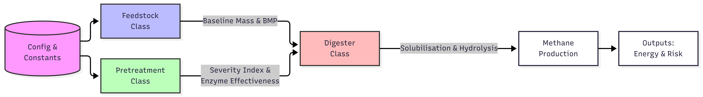

# ADM1 Simulation
**Project: Waste-to-Energy Simulation: Biogas Production from Food Waste Using Python**

feed composition → fungal pretreatment → solubilisation/hydrolysis → methane → energy →
risk

## Instructions
[TBA]

Optional: Install Better Comments extension for VSCode for better reading of codebase
```bash
Name: Better Comments
Id: aaron-bond.better-comments
Description: Improve your code commenting by annotating with alert, informational, TODOs, and more!
Version: 3.0.2
Publisher: Aaron Bond
VS Marketplace Link: https://marketplace.visualstudio.com/items?itemName=aaron-bond.better-comments
```

## Structure

```
/ADM1-simulation
├── AD/
├── data/
├── notebook/
├── pretreatment/
├── main.py
├── README.md
└── requirements.txt
```