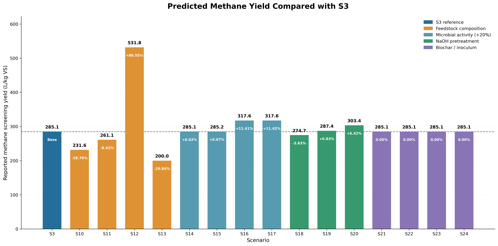
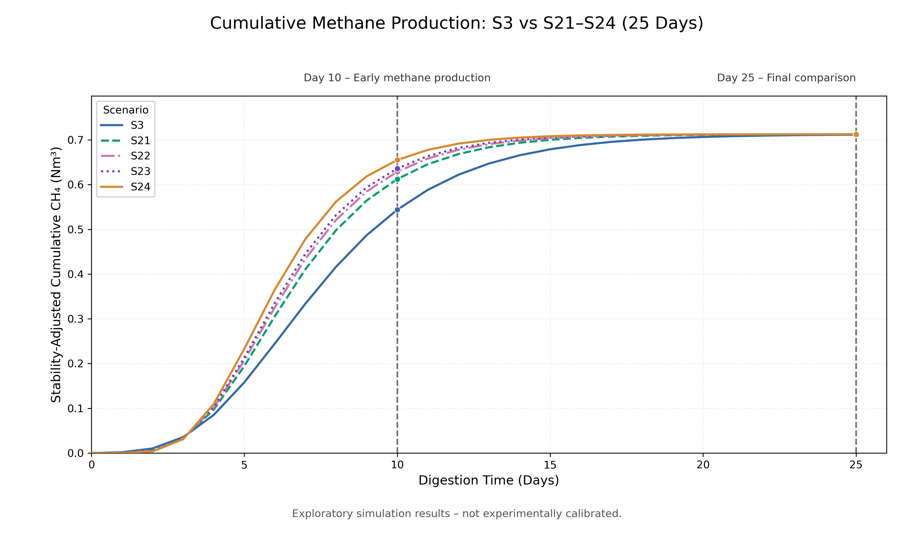
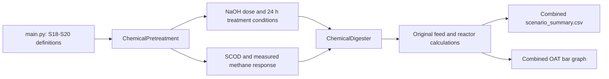
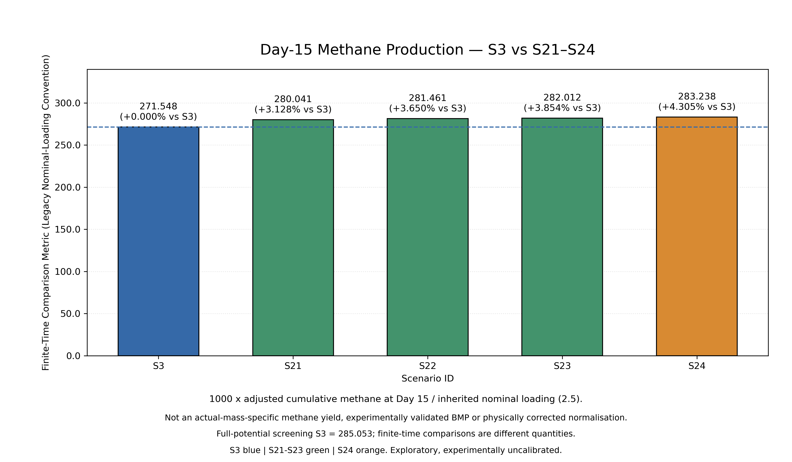
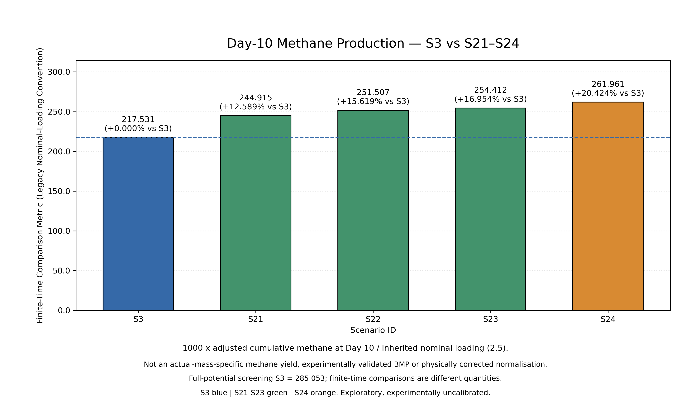
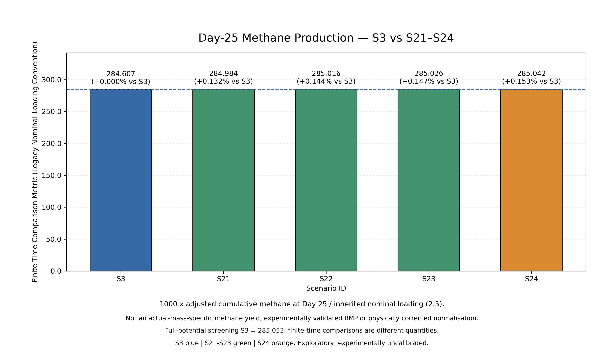

# Scenario Finalisation — S10–S24

**Current combined local version | 4 November 2026 | Prepared for Dr Bita**

This document consolidates the extended-scenario definitions, implemented methods, saved results and limitations. S3 is the fungal-treatment comparison reference. It is the single finalisation record for S10–S24. Detailed historical chemical and biochar/inoculum notes are preserved in the appendices below.

**Status:** the combined local implementation runs and produces S3 and S10–S24 outputs. The optional automated test suite has been removed from this delivery; the previous 30-test pass is a historical check. The results are model predictions, not experimentally validated performance. No new GitHub commit, push or PR merge was made during this finalisation.

## 1. Common reference and operating inputs

| Input | Configured value |
|---|---|
| Comparison reference | S3: food waste with fungal pretreatment |
| S3 composition fractions | Carbohydrate 0.50; protein 0.25; lipid 0.20; inert 0.05 |
| Fungal dose for S3 and extended fungal cases | 60 U/g VS |
| Fungal pretreatment | 24 hours; 30°C; pH 5.5 |
| Standard wet feed input | 10 kg |
| Total-solids fraction | 0.25 |
| VS/TS fraction | 0.90 |
| Calculated substrate VS | 2.25 kg |
| Reactor volume setting | 1 m³ |
| Nominal scenario OLR | 2.5 kg VS/m³/day |
| Digestion duration / HRT setting | 25 days |
| S3 substrate-to-inoculum reference for S21–S24 analysis | 1 g substrate VS/g inoculum VS |

These are configured values and reporting conventions. In particular, the nominal OLR is not equal to the actual feed loading obtained from 2.25 kg VS and the 1 m³ reactor setting.

## 2. Final scenario definitions

| Scenario | Material or parameter changed | Specific setting | Pretreatment |
|---|---|---|---|
| S10 | Cooked-rice feed profile | 100% rice profile | Fungal retained |
| S11 | Meat-waste feed profile | 100% meat profile | Fungal retained |
| S12 | Plant-oil feed profile | 100% oil profile | Fungal retained |
| S13 | Banana-peel feed profile | 100% peel profile | Fungal retained |
| S14 | Acidogenic activity parameter | k_max: 30 → 36 per day | Fungal retained |
| S15 | Acetogenic activity parameter | k_max: 13 → 15.6 per day | Fungal retained |
| S16 | Acetoclastic activity parameter | k_max: 8 → 9.6 per day | Fungal retained |
| S17 | Hydrogenotrophic activity parameter | k_max: 35 → 42 per day | Fungal retained |
| S18 | NaOH dose | 1 wt%; 10 g/kg wet waste | Replaces fungal |
| S19 | NaOH dose | 2 wt%; 20 g/kg wet waste | Replaces fungal |
| S20 | NaOH dose | 3 wt%; 30 g/kg wet waste | Replaces fungal |
| S21 | Biochar concentration | 5 g/L; S:I = 1 | Fungal retained |
| S22 | Biochar concentration | 10 g/L; S:I = 1 | Fungal retained |
| S23 | Biochar concentration | 15 g/L; S:I = 1 | Fungal retained |
| S24 | Substrate-to-inoculum ratio | S:I = 0.33; biochar = 0 g/L | Fungal retained |

S14–S17 specify the intended +20% target change. The current loop also retains earlier microbial changes through a shared parameter dictionary; the saved results therefore describe the delivered sequence, not verified independent one-factor microbial comparisons.

### S10–S13 composition inputs

Fractions below sum to one within each configured profile.

| Profile | Carbohydrate | Protein | Lipid | Inert |
|---|---:|---:|---:|---:|
| S3 food waste | 0.5000 | 0.2500 | 0.2000 | 0.0500 |
| S10 rice | 0.9206 | 0.0713 | 0.0072 | 0.0009 |
| S11 meat | 0.0830 | 0.9040 | 0.0130 | 0.0000 |
| S12 oil | 0.0000 | 0.0000 | 0.9999 | 0.0001 |
| S13 peel | 0.8190 | 0.0390 | 0.0070 | 0.1350 |

These are simplified model categories. The code comments identify normalisation for meat and peel, an almost pure-lipid oil assumption, and assignment of peel fibre to carbohydrate and lignin to inert. They do not represent full chemical characterisation of each waste.

### S18–S20 chemical inputs

NaOH treatment records 24 hours at 4°C, HCl neutralisation and post-treatment pH 6.2 ±0.1. These conditions are inputs/reference metadata rather than a dynamic chemical-reaction model. For the 10 kg feed input, NaOH masses are 0.1, 0.2 and 0.3 kg.

The SCOD response uses formulas 63–65:
```text
R_chem = C^n / (K_C^n + C^n)
SCOD_treated = SCOD_control × (1 + alpha_chem × R_chem)
k_hyd_treated = k_hyd_control × (1 + beta_chem × R_chem)
```

Configured coefficients are K_C = 0.334 wt%, n = 1.370 and alpha_chem = 0.898, fitted to source SCOD ratios. They are not directly reported coefficients. beta_chem = 0 disables extra hydrolysis enhancement; baseline hydrolysis and lag are 0.25/day and 3.8 days.

The implemented methane response applies source treated/control methane ratios to baseline biodegradable fractions, capped at one:
- S18: 393.1/370.2.
- S19: 411.3/370.2.
- S20: 434.1/370.2.

Thus, final methane differences are not generated solely from SCOD or standard ADM1 chemistry. No additional sodium-inhibition factor is applied. Stored K_I = 0.21 mol Na+/L and m = 1 refer to a separate sodium-concentration basis; they must not be treated as a verified inhibition coefficient in pretreatment wt%. The applied inhibition factor is one.

### S21–S24 response inputs

These cases use the S3 fungal treatment and the same assumed charge potential. Biochar response follows the configured equation-register Hill response and coefficient enhancement:
```text
R_add = C^n / (K^n + C^n)
biochar_factor = (1 + alpha × R_add) × I_add
inoculum_capacity = (1 + h) / (1 + h × S:I / reference_S:I)
```

Configured values are n = 1, K = 5 g/L, alpha = 0.5, h = 1 and reference S:I = 1. Biochar inhibition is disabled; its stored scale of 30 g/L and exponent 2 are assumptions, not measured toxicity limits. These responses scale a finite-charge, origin-normalised Gompertz rate proxy, not a mechanistic ADM1 methanogen state.

At the configured 1 m³ volume, S21–S23 correspond to 5, 10 and 15 kg biochar. S24 requires approximately 6.818 kg inoculum VS for 2.25 kg substrate VS. These mass calculations do not establish practical working-volume feasibility.

## 3. Combined screening results

Source: [current combined CSV](output/main_results/scenario_summary.csv).

| Scenario | Reported screening yield* | Change vs S3 |
|---|---:|---:|
| S3 | 285.053 | Reference |
| S10 | 231.587 | -18.76% |
| S11 | 261.056 | -8.42% |
| S12 | 531.768 | +86.55% |
| S13 | 199.986 | -29.84% |
| S14 | 285.104 | +0.02% |
| S15 | 285.243 | +0.07% |
| S16 | 317.586 | +11.41% |
| S17 | 317.603 | +11.42% |
| S18 | 274.711 | -3.63% |
| S19 | 287.430 | +0.83% |
| S20 | 303.364 | +6.42% |
| S21 | 285.053 | 0.00% |
| S22 | 285.053 | 0.00% |
| S23 | 285.053 | 0.00% |
| S24 | 285.053 | 0.00% |

*The CSV labels this column `Specific Yield (L/kgVS)`. It is the inherited stability-adjusted screening metric using the numerical nominal-loading denominator. It is not a physically normalised batch yield per actual substrate VS mass.

Percentages use `100 × (scenario value / S3 value − 1)`. Values above come from the saved CSV, before rounding for this table. The CSV's separate `Improvement (%)` compares against an untreated control; it is not change vs S3. For S14–S17, that stored improvement field is not fully refreshed after the ODE result replaces the original treated methane.



**Figure 1.** Reported screening results for S3 and S10–S24. Colours identify scenario groups; the dashed line is S3. Percentage labels compare each reported value with S3 using the same screening convention.

## 4. Biochar/inoculum finite-time results

The unchanged full-potential screening metric does not mean S21–S24 have identical time curves. Their assumed response changes conversion speed while retaining ultimate potential.

The following table uses the **actual-substrate-VS-mass**, stability-adjusted batch yield: `1000 × adjusted cumulative methane / 2.25 kg substrate VS`. It must not be mixed with the screening values in Section 3.

| Scenario | Day 10 (L/kg substrate VS) | Change vs S3 at Day 10 | Day 25 (L/kg substrate VS) | Change vs S3 at Day 25 |
|---|---:|---:|---:|---:|
| S3 | 241.702 | +0.000% | 316.230 | +0.000% |
| S21 | 272.128 | +12.589% | 316.649 | +0.132% |
| S22 | 279.452 | +15.619% | 316.684 | +0.144% |
| S23 | 282.680 | +16.954% | 316.695 | +0.147% |
| S24 | 291.067 | +20.424% | 316.714 | +0.153% |

Source: [presentation summary](output/tables/biochar_inoculum_summary_presentation.csv). The detailed summary and daily time series retain greater precision. The existing Day-10/15/25 bar charts use the separately labelled legacy nominal-loading convention; their absolute numbers differ from this actual-mass table.



**Figure 2.** Stability-adjusted finite-charge methane volumes for S3 and S21–S24 over 25 days. Larger early differences become small by Day 25 because all five cases retain the same assumed ultimate potential.

## 5. Interpretation and recommendations

- **Feedstock:** S12 has the highest reported screening result, 531.768, or 86.55% above S3. This is a result of the configured almost pure-lipid profile, not proof that feeding pure plant oil is a practical optimum.
- **Microbial parameters:** S16 and S17 have similar reported values, approximately 317.6. Review the accumulated parameter changes before ranking independent microbial interventions.
- **Chemical treatment:** S20 has the highest reported result among S18–S20: 303.364, or 6.42% above S3. It is a candidate for further testing. S19 gives 287.430, or 0.83% above S3, with a smaller NaOH dose. Cost-effectiveness and sodium effects are not established.
- **Biochar/inoculum:** S24 gives the largest modelled early improvement in the five-case batch comparison. S23 has the largest early response among the tested biochar doses. Neither establishes a greater ultimate methane potential; added material requirements and experimental calibration need review.

These recommendations concern model screening and further investigation, not deployment decisions.

## 6. Verification and remaining limitations

The integrated project was run successfully, and its exported S3 and S10–S20 values were checked unchanged when S21–S24 was added. The optional S21–S24 and legacy-screening test suite passed 30 tests before being removed at the user's request. No automated test suite is included in this delivery.

After removal, `main.py` was rerun and its combined CSV was compared with the preceding saved results. Removing the test files did not change the simulation results. These software checks are not laboratory experiments or independent scientific validation.

The principal review items are:
1. Nominal loading versus actual substrate-mass normalisation, and inherited daily/batch labels.
2. Shared microbial-parameter changes across S14–S17 and derived energy/improvement fields not fully recalculated after ODE methane is assigned.
3. NaOH replacing fungal treatment rather than combining both.
4. Fitted chemical coefficients and transferred methane ratios from different experimental conditions; no separate dynamic sodium-inhibition model.
5. Uncalibrated biochar/inoculum response magnitudes, fixed ultimate potential and unverified inoculum/working-volume feasibility.
6. Different conventions between the general combined curves and the dedicated origin-normalised biochar batch comparison.

This is a simplified screening model with an existing microbial ODE pathway, not a full standard dynamic ADM1 implementation. Software integration is complete for the delivered scope; independent experimental validation remains outstanding.

## 7. Evidence and reproduction

- Run `python main.py` in a fresh Python process from the project root.
- Scenario definitions: `main.py` (S1–S24 in one scenario list).
- Composition, digestion and microbial inputs: `data/config.py`.
- NaOH inputs and literature benchmarks: `data/chemical_config.py`.
- Calculation classes/functions: `AD/` and `pretreatment/`.
- Combined table and primary graph: `output/main_results/`.
- Group graphs: `output/other_graphs/`.
- Biochar detailed tables: `output/tables/`.
- Daily data, parameter assumptions and sensitivity outputs: `output/supporting/`.
- Receiving-team instructions: [README.md](README.md).

The chemical source recorded in configuration is Zhen et al. (2023), DOI 10.1515/gps-2023-0072. The microbial configuration cites Rocha et al., PeerJ article 16720. Biochar/inoculum source comparisons and assumed-versus-sourced parameter distinctions are retained in `output/supporting/s21_s24_parameter_verification.csv` and `s21_s24_literature_comparison.csv`. This consolidation does not newly verify the underlying publications.

The local snapshot combines pretreatment commit `6aa1dc6`, NaOH implementation `fae8ad3` and teammate biochar/inoculum branch tip `1add31c`, adapted locally. No new commit, push or GitHub merge was performed for this document.

## Appendix A. Historical S18–S20 development notes

<details>
<summary>Expand detailed chemical-treatment notes</summary>

These are preserved development notes. For current scope, limitations and interpretation, use Sections 1–7 above. Historical recommendations, uncertainty claims and inhibition wording below do not constitute independent validation.

### Final Scenarios S18-S20: NaOH Pretreatment

#### Final decision

S18-S20 are the project's final one-at-a-time NaOH pretreatment scenarios. The
feedstock, reactor volume, organic loading rate and hydraulic retention time are
held constant, while NaOH concentration changes from 1 to 3 wt%. The treatment
response is anchored to the measured kitchen-waste results reported by Zhen et
al. (2023).

**S20 is the recommended maximum-performance scenario within the evaluated
1-3 wt% NaOH range.** It produces the highest specific methane yield, methane
volume, methane concentration and gross energy output of S18-S20. **S19 is the
recommended lower-chemical-use option** because its specific methane yield is
approximately equal to the S3 reference while using 2 wt% rather than 3 wt%
NaOH.

#### Scenario parameters

| Parameter | S18 | S19 | S20 | Basis |
|---|---:|---:|---:|---|
| Chemical | NaOH | NaOH | NaOH | Fixed OAT factor |
| NaOH concentration | 1 wt% | 2 wt% | 3 wt% | Wet food-waste mass |
| Wet feed | 10.0 kg/d | 10.0 kg/d | 10.0 kg/d | Unchanged source-model input |
| NaOH mass | 0.1000 kg/d | 0.2000 kg/d | 0.3000 kg/d | Calculated from wet feed |
| Pretreatment time | 24 h | 24 h | 24 h | Zhen et al. (2023) |
| Pretreatment temperature | 4 C | 4 C | 4 C | Zhen et al. (2023) |
| Neutralisation | 1 mol/L HCl | 1 mol/L HCl | 1 mol/L HCl | Zhen et al. (2023) |
| Post-treatment pH | 6.2 +/- 0.1 | 6.2 +/- 0.1 | 6.2 +/- 0.1 | Zhen et al. (2023) |
| Scenario OLR setting | 2.5 kg VS/m3/d | 2.5 kg VS/m3/d | 2.5 kg VS/m3/d | Unchanged source-model input |
| Project HRT | 25 d | 25 d | 25 d | Held constant |
| Chemical inhibition factor | 1.0 | 1.0 | 1.0 | Net published response; no duplicate sodium penalty |

The source experiment used 100 g treated waste, 300 mL activated sludge,
dilution to 1 L, digestion at 37 C for 50 days, and three replicates. Those
conditions are recorded in `CHEMICAL_PRETREATMENT_CONFIG` as reference metadata;
they are not substituted for the project reactor conditions.

#### Final chemical-model parameters

| Parameter | Final value | Function and basis |
|---|---:|---|
| `K_C` | 0.334 wt% | Half-response concentration fitted to reported SCOD ratios |
| `n` | 1.370 | Shape coefficient fitted to reported SCOD ratios |
| `alpha_chem` | 0.898 | Maximum SCOD-response coefficient |
| `beta_chem` | 0.000 | SCOD represents solubilisation and the measured methane ratios represent the net treatment response, avoiding duplicate enhancement |
| Baseline `k_hyd` | 0.250 1/d | Project hydrolysis constant retained in the response-calibrated structure |
| Baseline lag phase | 3.800 d | Project lag parameter retained in the response-calibrated structure |
| Sodium `K_I` | 0.210 mol Na+/L | Hierholtzer and Akunna (2012) ADM1 sodium parameter |
| Sodium exponent `m` | 1.000 | Non-competitive inhibition form |
| Applied inhibition factor | 1.000 | Published methane yields are net measured responses that already include treatment sodium |

For the source 1 L digestion protocol, the NaOH additions correspond to the
following sodium concentrations after dilution:

| Scenario | Sodium concentration | Sodium mass concentration | Relation to `K_I` |
|---|---:|---:|---:|
| S18 | 0.025 mol/L | 0.575 g/L | 11.9% of `K_I` |
| S19 | 0.050 mol/L | 1.150 g/L | 23.8% of `K_I` |
| S20 | 0.075 mol/L | 1.725 g/L | 35.7% of `K_I` |

These concentrations are below the 0.21 mol/L sodium parameter and below the
8 g/L strong-inhibition boundary reported for kitchen-waste digestion by Anwar
et al. (2016). The final model therefore uses the observed net methane response
without applying a second sodium penalty.

#### Implemented workflow



The chemical classes are selected only for S18-S20. S1-S13 continue through
the original pretreatment and digester classes, so their calculation path and
outputs are unchanged.

#### Literature anchors

| Measure | Control | S18 | S19 | S20 |
|---|---:|---:|---:|---:|
| Reported SCOD | 134.6 +/- 2.4 | 233.5 +/- 6.7 | 245.9 +/- 5.4 | 249.8 +/- 3.4 |
| SCOD increase vs control | - | 73.477% | 82.689% | 85.587% |
| CH4 yield (mL/g VS) | 370.2 +/- 3.1 | 393.1 +/- 0.9 | 411.3 +/- 2.5 | 434.1 +/- 1.7 |
| CH4 increase vs control | - | 6.186% | 11.102% | 17.261% |
| CH4 fraction | 54.8 +/- 4.7% | 60.4 +/- 3.6% | 61.3 +/- 0.9% | 61.7 +/- 2.1% |
| CO2 fraction | 39.6 +/- 1.5% | 31.8 +/- 1.6% | 30.6 +/- 1.7% | 30.0 +/- 2.1% |

The publication reports the control and treated SCOD values on inconsistent
bases in different sections. The implementation therefore uses SCOD ratios, not
the reported values as absolute project concentrations.

#### Updated project outputs

| Output | S18 | S19 | S20 |
|---|---:|---:|---:|
| Treated CH4 yield (Nm3/d) | 0.919 | 0.962 | 1.015 |
| Improvement vs untreated project control | 6.186% | 11.102% | 17.261% |
| Stability-adjusted specific yield (L/kg VS) | 274.711 +/- 2.385 | 287.430 +/- 2.974 | 303.364 +/- 2.804 |
| Difference vs S3 | -3.628% | +0.834% | +6.424% |
| Predicted CH4 fraction | 60.4% | 61.3% | 61.7% |
| Predicted CO2 fraction | 31.8% | 30.6% | 30.0% |
| Biogas volume (m3/d) | 1.522 | 1.569 | 1.645 |
| Gross methane energy (MJ/d) | 32.904 | 34.428 | 36.336 |
| Gross electricity potential (MJ/d) | 11.516 | 12.050 | 12.718 |

The uncertainty shown for project specific yield propagates the reported
methane-yield standard deviations from the source control and treatment groups.
It does not include project feedstock or reactor uncertainty.

The existing source model uses 10 kg/d wet feed, equivalent to 2.25 kg VS/d at
the configured TS and VS fractions, while its specific-yield calculation uses
the scenario OLR setting of 2.5. This inherited convention is intentionally left
unchanged so that S1-S13 retain their original outputs, including S3 at 285.053
L/kg VS.

#### Final recommendation

1. Select **S20 (3 wt% NaOH)** when the objective is maximum methane and energy
   performance within the evaluated 1-3 wt% range. It delivers 303.364 L
   CH4/kg VS, 6.424% above S3 and 17.261% above the untreated project control.
2. Select **S19 (2 wt% NaOH)** when the objective is lower chemical use with
   S3-equivalent performance. It delivers 287.430 L CH4/kg VS, 0.834% above S3.
3. Do not select **S18 (1 wt% NaOH)** when the decision criterion is methane
   performance relative to S3; its specific yield is 3.628% below S3.

The project recommendation for S18-S20 is therefore **S20 for performance** and
**S19 for reduced chemical consumption**.

#### References

1. Zhen, X., Li, S., Jiao, R., Wu, W., Dong, T., and Liu, J. (2023).
   Effect of pretreatment with alkali on the anaerobic digestion
   characteristics of kitchen waste and analysis of microbial diversity.
   *Green Processing and Synthesis*, 12(1), 20230072.
   https://doi.org/10.1515/gps-2023-0072
2. Hierholtzer, A., and Akunna, J. C. (2012). Modelling sodium inhibition on
   the anaerobic digestion process. *Water Science and Technology*, 66(7),
   1565-1573. https://doi.org/10.2166/wst.2012.345
3. Anwar, N., Wang, W., Zhang, J., Li, Y., Chen, C., Liu, G., and Zhang, R.
   (2016). Effect of sodium salt on anaerobic digestion of kitchen waste.
   *Water Science and Technology*, 73(8), 1865-1871.
   https://doi.org/10.2166/wst.2016.035
4. Bala, R., Gupta, G. K., Dasgupta, B. V., and Mondal, M. K. (2019).
   Pretreatment optimisation and kinetics of batch anaerobic digestion of
   liquidised OFMSW treated with NaOH: Models verification with experimental
   data. *Journal of Environmental Management*, 237, 313-321.
   https://doi.org/10.1016/j.jenvman.2019.02.083
5. Feijoo, G., Soto, M., Mendez, R., and Lema, J. M. (1995). Sodium inhibition
   in the anaerobic digestion process: Antagonism and adaptation phenomena.
   *Enzyme and Microbial Technology*, 17(2), 180-188.
   https://doi.org/10.1016/0141-0229(94)00011-F
6. Batstone, D. J., Keller, J., Angelidaki, I., et al. (2002). The IWA
   Anaerobic Digestion Model No 1 (ADM1). *Water Science and Technology*,
   45(10), 65-73. https://doi.org/10.2166/wst.2002.0292
7. *Complete Formula Notation Scenario Literature Data*, 6 October 2026,
   Equations 63-66 and the S18-S20 literature table.

</details>

## Appendix B. Historical S21–S24 development notes

<details>
<summary>Expand detailed biochar/inoculum notes</summary>

These are preserved development notes. Historical branch names, commands and test counts refer to earlier stages. Use [README.md](README.md) for the delivered run instructions and current verification status. The commands and test counts below are historical; the test suite is no longer included.

### Final Scenarios S21-S24: Biochar Addition and Inoculum Loading

Updated 28 October 2026 | Branch: `biochar-inoculum`

#### Main results: Day-10 and Day-25 methane production

The following are **finite-time legacy nominal-loading metrics**, not the full-potential screening quantity described below. They use each scenario's own stability-adjusted cumulative methane at the stated day divided by the same numerical nominal-loading denominator 2.5. Raw values remain full precision.

| Scenario | Day-10 legacy metric | Day-10 change vs S3 | Day-25 legacy metric | Day-25 change vs S3 |
| --- | --- | --- | --- | --- |
| S3 | 217.531 | +0.000% | 284.607 | +0.000% |
| S21 | 244.915 | +12.589% | 284.984 | +0.132% |
| S22 | 251.507 | +15.619% | 285.016 | +0.144% |
| S23 | 254.412 | +16.954% | 285.026 | +0.147% |
| S24 | 261.961 | +20.424% | 285.042 | +0.153% |

Each percentage compares like-for-like metrics at the same day. The larger early differences reflect modelled conversion speed; small Day-25 differences reflect convergence toward the same assumed potential. These are exploratory predictions, not experimentally validated responses.

#### Methodology and exact S3 calculation

The original `Digester.get_practical_yields()` is unchanged:

```text
P = sum(component VS mass * component BMP * treated biodegradability)
s = inherited heuristic stability multiplier
Y_screen = 1000 * P * s / nominal_loading
```

The two finite-time reporting metrics are calculated independently:

```text
Y_legacy(t) = 1000 * C_adjusted(t) / nominal_loading, t=10 or 25 days
C_adjusted(t) = s * C(t)
Change(t) = 100 * [Y_legacy,scenario(t) / Y_legacy,S3(t) - 1]
```

All five cases have nominal loading 2.5. The denominator is read from the retained scenario/output setting; no methane value is hardcoded. The same stability multiplier is applied once, and there is no additional correction to methane potential.

S3 at full precision:

```text
P = 0.9683356212109677 Nm3
s = 0.735935091988353
C_adjusted(10) = 0.5438284773771739 Nm3
C_adjusted(25) = 0.7115179846921761 Nm3
Y_screen = 1000 * P * s / 2.5 = 285.05286578859705
Y_legacy(10) = 1000 * C_adjusted(10) / 2.5 = 217.53139095086956
Y_legacy(25) = 1000 * C_adjusted(25) / 2.5 = 284.60719387687044
```

The original screening calculation uses full methane potential. The finite-time comparisons use cumulative methane released by their respective days. Even with a common denominator, they are not interchangeable: Day 25 is slightly below full potential, and Day 10 is earlier in conversion.

##### Dimensional limitation

Nominal OLR has units kgVS/m3/day and is not substrate charge mass. Dividing a batch volume by the numerical loading value 2.5 is an inherited project screening convention, not a general physical L/kgVS equation. These graphs therefore name the convention explicitly and do not label the outputs as actual-substrate-mass yields. Matching the denominator provides project-convention consistency but does not correct that physical limitation.

The original feed charge is 10 kg wet * 0.25 TS * 0.90 VS/TS = 2.25 kg substrate VS. The nominal scenario OLR 2.5 differs from the actual legacy feed loading 2.25 kg VS/m3/day. This existing mismatch is preserved and disclosed, not silently corrected in one scenario group.

#### Day-15 methane production comparison

Day 15 uses the actual saved `Adjusted cumulative CH4 (Nm3)` rows at Day = 15, without interpolation or new simulation assumptions. The same inherited convention applies: `1000*C_adjusted(15)/2.5`. Percentages use unrounded Day-15 values and the Day-15 S3 reference. These are finite-time legacy comparison metrics, not experimentally validated specific methane yields. Existing Day-10/Day-25 results are unchanged.

| Scenario | Day-15 legacy comparison metric | Day-15 change vs S3 (%) |
| --- | --- | --- |
| S3 | 271.548 | +0.000% |
| S21 | 280.041 | +3.128% |
| S22 | 281.461 | +3.650% |
| S23 | 282.012 | +3.854% |
| S24 | 283.238 | +4.305% |



#### Main presentation: Day-10, Day-15, Day-25 and cumulative figures

1. **Day-10 Methane Production - S3 vs S21-S24**: each scenario's stability-adjusted cumulative methane at Day 10, using the inherited denominator 2.5.
2. **Day-25 Methane Production - S3 vs S21-S24**: the same finite-time convention at Day 25. Small differences are preserved without truncating the vertical axis.
3. **Cumulative methane production over 25 days**: the unchanged independent curves in stability-adjusted Nm3.






The cumulative curves use distinct colours: S3 blue, S21 green, S22 pink, S23 purple and S24 orange, with distinct line styles retained. Bar-chart colours remain grouped by scenario type.

The bar charts show finite-time legacy comparison metrics, not experimentally validated specific methane yields. S3 is blue, S21-S23 green and S24 orange. Values and same-day percentage changes are shown to three decimals; each dashed reference line is that time point's S3 value. Supporting numerical CSVs are retained; redundant supporting images are omitted.

#### Supporting full-potential screening reference

Direct team comparisons use the original `Digester.get_practical_yields()` calculation from commit `e241207` (18 October 2026), with the inherited nominal OLR denominator 2.5. S3 uses 10 kg wet feed, 2.5 kg TS and 2.25 kg VS; **2.25 kg is VS, not wet mass**. The configured OLR is distinct from the calculated total-solids mass despite both having the numerical value 2.5.

| Scenario | Biochar (g/L) | S ratio | Full-potential screening metric | Change vs S3 |
| --- | --- | --- | --- | --- |
| S3 | 0 | 1 | 285.053 | +0.000% |
| S21 | 5 | 1 | 285.053 | +0.000% |
| S22 | 10 | 1 | 285.053 | +0.000% |
| S23 | 15 | 1 | 285.053 | +0.000% |
| S24 | 0 | 0.33 | 285.053 | +0.000% |

Graph values use the team's one-decimal presentation (285.1); the underlying reference is 285.05286578859705. Each scenario's screening value is independently calculated using its Digester. Identical results are expected: the current additive/inoculum implementation changes apparent conversion rate, while potential and stability remain fixed. This flat comparison does not demonstrate methane enhancement and is not evidence that the kinetic responses are ignored.

The original full-potential screening values remain in the CSVs and table; the redundant flat screening image is omitted.

#### Retained actual-mass batch results: supporting analysis

The physical substrate-mass normalisation remains unchanged:

```text
Y_batch(t) = 1000 * C_adjusted(t) / 2.25 kg substrate VS
```

| Scenario | Day-10 batch yield (L CH4/kg substrate VS) | Day-10 change | Day-25 batch yield (L CH4/kg substrate VS) | Day-25 change |
| --- | --- | --- | --- | --- |
| S3 | 241.702 | +0.000% | 316.230 | +0.000% |
| S21 | 272.128 | +12.589% | 316.649 | +0.132% |
| S22 | 279.452 | +15.619% | 316.684 | +0.144% |
| S23 | 282.680 | +16.954% | 316.695 | +0.147% |
| S24 | 291.067 | +20.424% | 316.714 | +0.153% |

These are different numerical quantities from the primary legacy-convention metrics. Their relative percentage changes are equal because the common denominator changes by the same factor for every scenario. Neither actual-mass batch reference is replaced with 285.053.

The relationship is `Y_legacy(t)=Y_batch(t)*2.25/2.5`, derived from the denominators and existing cumulative volume, not an arbitrary fitted multiplier. Actual-mass results remain in the table and CSVs. Older supporting graph copies have been removed; full-precision data remain authoritative.

#### Scientific interpretation

Biochar and inoculum changes affect the apparent conversion rate in this implementation. Each factor is applied once. The scenarios have different independently calculated curves and finite-time results, but the same assumed methane potential, inherited lag, biodegradability and stability multiplier.

S3 already reaches approximately 99.844% of the treated potential at Day 25. The available endpoint gain at fixed potential is therefore limited to about 0.157%. Day 10 changes are larger because conversion is incomplete. The small Day 25 differences are expected model behaviour, not evidence that the variables are ignored or of an experimentally small biochar benefit.

Equations 84-86 provide a kinetic response structure, not a validated BMP enhancement. Equation 89 defines inoculum mass only; its added saturating capacity response is an explicit assumption. Literature supports the biochar identity/dose and ratio design levels, not the current response magnitudes. Alpha = 0.5, K = 5 g/L, n = 1 and inoculum half-capacity = 1 remain uncalibrated. Inhibition KI = 30 g/L, m = 2 is unverified and disabled by default. No additional potential/stability mechanism was introduced.

These deterministic outputs do not establish experimental significance, optimal concentration, real-world stability benefit or economic advantage. Matched experimental time series, inoculum activity/blanks, biochar characterisation and separate calibration/validation data remain necessary.

#### Scenario parameters

| Scenario | Biochar (g/L) | S:I (g substrate VS/g inoculum VS) | Biochar mass (kg) | Inoculum VS (kg) |
| --- | --- | --- | --- | --- |
| S3 | 0 | 1 | 0.00 | 2.250 |
| S21 | 5 | 1 | 5.00 | 2.250 |
| S22 | 10 | 1 | 10.00 | 2.250 |
| S23 | 15 | 1 | 15.00 | 2.250 |
| S24 | 0 | 0.33 | 0.00 | 6.818 |

All masses in this comparison refer to the **same fixed substrate charge**, not continuous daily inoculum or biochar dosing. S3's S:I baseline of 1 is an explicit modelling assumption. Official S24 was changed from 2 to 0.33 following the formula-register recommendation; 2 remains an additional sensitivity case.

| Shared parameter | Value | Basis/status |
|---|---|---|
| Substrate | 100% baseline food waste; no SCG | Same composition in all five cases |
| Organic fractions | Carbohydrate 0.50; protein 0.25; lipid 0.20; inert 0.05 | Existing project composition |
| Wet substrate charge | 10 kg | Retained reference basis |
| Total solids fraction | 0.25 | 2.5 kg TS |
| VS/TS | 0.90 | **2.25 kg substrate VS** |
| Reactor working-volume basis | 1 m3 | Fixed; inoculum carrier liquid assumed adjusted |
| Fungal enzyme dose | 60 U/g VS | S3 reference |
| Fungal pretreatment | 24 h, 30 C, pH 5.5 | S3 reference; not digestion temperature |
| Batch observation window | 25 days | Same window for all cases; not a solved CSTR HRT balance |
| Biochar identity | Rice-husk biochar RHB550, pyrolysis at 550 C | Same assumed identity across S21-S23; batch properties uncharacterised |
| Nominal legacy OLR | 2.5 kg VS/m3/day | Retained metadata; actual legacy daily feed corresponds to 2.25 |
| Treated methane potential | 0.9683356212 Nm3/charge | Identical across all five cases |
| Composition theoretical methane ceiling | 1.202175 Nm3/charge | No added methane credited to biochar or inoculum |
| Fixed inherited lag | 3.279107 days | No additional biochar/inoculum lag reduction |
| Heuristic stability multiplier | 0.735935092 | Identical across all five cases; uncalibrated |

#### Final model parameters and equations

| Parameter | Final setting | Scientific status |
|---|---|---|
| Biochar benefit coefficient, alpha_add | 0.5 | Unverified legacy assumption |
| Half-response concentration, K_add | 5 g/L | Unverified; not inferred from the 5 g/L experimental dose |
| Response exponent, n | 1 | Unverified shape assumption |
| High-dose inhibition | **Disabled by default** | No sufficiently matched inhibition evidence |
| Inhibition concentration, K_I,add | 30 g/L, inactive | Unverified optional sensitivity parameter |
| Inhibition exponent, m | 2, inactive | Unverified optional sensitivity parameter |
| Inoculum half-capacity, h | 1 | Unverified empirical capacity proxy |
| Empirical rate scale | 1 | Reference scaling; not a fitted ADM1 coefficient |
| Additional lag scaling | Removed | Not justified by Equations 84-86 or 89 |

The supplied register provides these relationships:

```text
Eq.84: R_add = C_add^n / (K_add^n + C_add^n)
Eq. 85: k_meth* = k_meth,0 * (1 + alpha_add*R_add) * I_add
Eq.86: I_add = 1 / (1 + (C_add/K_I,add)^m) [optional]
Eq.89: S:I = M_substrate,VS / M_inoculum,VS
       M_inoculum,VS = M_substrate,VS / (S:I)
```

C_add and K_add use the same g/L units; the response and inhibition factors are dimensionless. Equation 89 is a mass identity; it does not independently predict methane production.

**The S21-S24 route uses an empirical Gompertz approximation, not a mechanistic ADM1 methanogenic coefficient.** It uses the dimensionless Eq. 85 response structure as an explicitly exploratory multiplier on apparent conversion speed. It does not claim that the inherited hydrolysis descriptor is a measured k_meth. The separate dynamic ADM1 implementation is not modified by these scenarios.

The optional inoculum response is `f_I=(1+h)/(1+h*(S:I)/(S:I)_reference)`. This saturating proxy is an assumption, not Equation 89. The apparent rate is the inherited rate multiplied once by the biochar and inoculum factors; methane potential and inherited lag remain fixed. The Gompertz curve is origin-normalised to zero cumulative methane at day 0, and daily production is the difference between successive cumulative values.


##### Meaning of the exported R_max value

The existing raw CSV column `Empirical Gompertz Rmax (Nm3/day)` is retained for compatibility. Its value is:

```text
R_max,underlying = P * k_app / e
```

It is a parameter of the **underlying, unnormalised, unpenalised Gompertz curve**. It is not a measured maximum daily methane production rate, not a daily time-step increment, and not the exact maximum derivative of the reported origin-normalised, stability-adjusted curve. The presentation CSV includes an explanatory `Rmax description` column; the numerical values are unchanged.

For interpretation, if G(t) denotes the underlying Gompertz curve and s the stability multiplier:

```text
C_adjusted(t) = s * P * [G(t)-G(0)] / [P-G(0)]
dC_adjusted/dt = s * P / [P-G(0)] * dG/dt
```

Thus origin normalisation and stability scaling change the derivative relative to the underlying parameter. This relation explains terminology only; no additional rate correction is applied to the model. Daily methane in the time-series CSV remains the increment between successive cumulative volumes, with adjusted and unpenalised increments labelled separately. Graphs show finite-time yield, percentage change or cumulative volume, not measured R_max.


#### S24 substrate-to-inoculum sensitivity study

S3 is fixed at S = 1, no biochar, substrate VS = 2.25 kg and nominal loading = 2.5. Its original full-potential screening result remains 285.053; its finite-time references remain 217.531 at Day 10 and 284.607 at Day 25. These are different output definitions.

Each sensitivity case is a fresh copy of S3 with **only `si_ratio` changed**. Equation 89 gives `inoculum VS = 2.25/S`. The existing empirical response is `f_I=(1+h)/(1+h*S/S_reference)`, with unchanged h = 1 and S_reference = 1; therefore `f_I=2/(1+S)`. It multiplies the apparent conversion rate once. Potential, stability, substrate mass, lag and biochar remain fixed.

Both cumulative columns below are stability-adjusted Nm3. Legacy metrics use `1000*C_adjusted(t)/2.5`; percentages use unrounded same-time S3 values. Unpenalised cumulative volumes and actual-mass batch yields are retained separately in the new full-precision sensitivity CSV.

| S ratio | Inoculum VS (kg) | Day-10 CH4 (Nm3) | Day-25 CH4 (Nm3) | Day-10 legacy metric | Change (%) | Day-25 legacy metric | Change (%) |
| --- | --- | --- | --- | --- | --- | --- | --- |
| 0.33 | 6.818 | 0.654901 | 0.712606 | 261.961 | +20.424 | 285.042 | +0.153 |
| 0.5 | 4.500 | 0.628768 | 0.712539 | 251.507 | +15.619 | 285.016 | +0.144 |
| 1 | 2.250 | 0.543828 | 0.711518 | 217.531 | +0.000 | 284.607 | +0.000 |
| 1.5 | 1.500 | 0.463808 | 0.707687 | 185.523 | -14.714 | 283.075 | -0.538 |
| 2 | 1.125 | 0.396658 | 0.699313 | 158.663 | -27.062 | 279.725 | -1.715 |

Sensitivity results are retained in the table and supporting CSV only; no additional sensitivity figures are generated.

**Recommendation:** retain S = 0.33 for the main S24 configuration because it is the previously documented literature-anchor initial case and tests increased inoculum availability against a defined S3 baseline. Retain S = 2 as the contrasting reduced-inoculum case; it tests slower conversion and incomplete recovery by Day 25. This recommendation is based on the experimental design and documented literature anchor, not on choosing the highest predicted methane value. Neither ratio is an established optimum. S = 0.5 and 1.5 provide intermediate sensitivity checks; 1.5 is a modelling interpolation, not a verified experimental datum from the supplied sources.

Lower S increases assumed conversion speed and early methane; higher S reduces them. Day-25 differences shrink as curves approach the same assumed potential, although slower cases remain further from that limit. All full-potential screening values remain 285.053.

**Validity and limitations:** the proxy is finite and positive throughout 0.33-2, equals one at S3, and is bounded above by two as S approaches zero. Mathematical boundedness does not establish biological validity. All off-baseline response magnitudes are uncalibrated, including the literature-anchor ratio. The model omits inoculum activity differences, endogenous inoculum methane, dilution/working-volume constraints, inhibition from substrate overload and changes in buffering or stability. Holding reactor volume fixed while increasing inoculum VS may be infeasible without measured inoculum solids concentrations and a volume balance. Do not extrapolate this empirical response outside the tested range or interpret it as a calibrated mass-to-methane mechanism.

[Full-precision S24 sensitivity CSV](output/supporting/s24_ratio_sensitivity.csv). Reproduce only these new outputs with `python -B -m utils.s24_sensitivity`. They are also regenerated by `python main.py`. The extended focused suite completed with **28 passed** using `python -B -m pytest tests/test_biochar_inoculum.py -q -p no:cacheprovider`. Existing raw CSVs and original model/configuration files were checked byte-for-byte unchanged during this sensitivity run.

#### Recommendations

- **S21, 5 g/L:** first lower-dose biochar experiment. It produces a substantial assumed early kinetic effect with lower material use than S22/S23; this is not proof of a resource or cost optimum.
- **S22/S23:** retain for dose-response calibration. Increasing dose produces faster conversion under the current uncalibrated coefficients; no universal monotonic benefit is claimed.
- **S24, S:I = 0.33:** retain as the literature-anchor increased-inoculum case. It requires 6.818182 kg inoculum VS for 2.25 kg substrate VS, rather than S3's 2.25 kg. Confirm activity, endogenous methane and resource requirements experimentally.
- **S3:** preserve the original screening equations and baseline. Do not compare finite-time results directly against full-potential 285.053 as if they were the same time-dependent quantity.

#### Data files and reproduction

- [Raw scenario summary](output/tables/biochar_inoculum_summary.csv): all original columns retained, plus full-precision Day 10/Day 25 legacy-convention derived columns.
- [Presentation summary](output/tables/biochar_inoculum_summary_presentation.csv): comparison values and percentages to 3 decimal places; definitions remain explicit.
- [Raw cumulative time series](output/supporting/biochar_inoculum_timeseries.csv): unchanged methane volumes and actual-mass yields.
- [Shared project summary](output/main_results/scenario_summary.csv): existing screening and batch values retained, with appended derived fields.
- Supporting parameter-verification, sensitivity and literature-comparison CSVs remain available. No original simulation output was deleted.

```powershell
python -B main.py --biochar-only
python -B -m unittest discover -s tests -p test_biochar_inoculum.py -q
```

Verification: `python -m pytest tests/test_biochar_inoculum.py -q -p no:cacheprovider` completed with **27 passed**. `git diff --check` also passed.

The exporter maintains four main figures: Day-10, Day-15 and Day-25 comparisons, plus cumulative kinetics. The full-potential screening data and S-ratio CSV remain supporting analyses; supporting PNGs are not generated automatically. Derived metric additions are reporting calculations only; original simulation functions, coefficients, nominal loading, potential and stability remain untouched.

#### Team-reporting verification

The team-standard screening update was verified with `python -B -m pytest tests/test_biochar_inoculum.py -q -p no:cacheprovider`: **29 passed**. All existing CSV files, the cumulative graph and original model/configuration files were checked byte-for-byte unchanged. The update changes reporting code, graph placement, the report and focused tests only.

#### References

1. Ovi, D.; Chang, S.W.; Wong, J.W.C.; et al. (2022). Effect of rice husk and palm tree-based biochar addition on the anaerobic digestion of food waste/sludge. *Fuel*, 315, 123188. https://doi.org/10.1016/j.fuel.2022.123188
2. Kawai, M.; Nagao, N.; Tajima, N.; Niwa, C.; Matsuyama, T.; Toda, T. (2014). The effect of the labile organic fraction in food waste and the substrate/inoculum ratio on anaerobic digestion for a reliable methane yield. *Bioresource Technology*, 157, 174-180. https://doi.org/10.1016/j.biortech.2014.01.018
3. Rocha, M.E.; Lazarino, T.C.; Oliveira, G.; et al. (2024). Analysis of biogas production from sewage sludge combining BMP experimental assays and the ADM1 model. *PeerJ*, 12, e16720. https://doi.org/10.7717/peerj.16720
4. Zaferanloo, P.; Hossain, M.I.; Maehara, S.; Ektesabi, M.; Malherbe, F.; Zaferanloo, B. (2026). Fungal Pretreatment-Assisted Methane Recovery from Food Waste: A Literature-Informed Simulation Framework. *Molecules*, 31, 3594. https://doi.org/10.3390/molecules31203594
5. *Complete Formula Notation Scenario Literature Data - 6102026.pdf*, supplied working register: p. 20, Equations 84-86; p. 22, Equation 89; pp. 24-25 scenario/literature anchors.
6. *Bita feedback after our meeting in week 9.pdf*, supplied working report, updated 8 October 2026: OAT principles, S3 baseline requirements and Section 6, p. 5 biochar/inoculum literature anchors.

Reference values above come from the supplied documents and the earlier source audit. They are not presented as new measurements or fitted coefficients.

#### Final finite-time presentation verification

The two bar charts were regenerated from the existing full-precision CSV cumulative volumes; all same-day percentage changes were recalculated and verified. All existing CSV files, the cumulative graph and protected simulation/configuration files remained byte-for-byte unchanged. The focused suite completed with **29 passed** using `python -B -m pytest tests/test_biochar_inoculum.py -q -p no:cacheprovider`.

</details>
