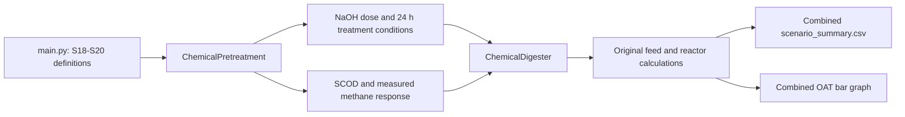

# Final Scenarios S18-S20: NaOH Pretreatment

## Final decision

S18-S20 are the project's final one-at-a-time NaOH pretreatment scenarios. The
feedstock, reactor volume, organic loading rate and hydraulic retention time are
held constant, while NaOH concentration changes from 1 to 3 wt%. The treatment
response is anchored to the measured kitchen-waste results reported by Zhen et
al. (2023).

**S20 is the recommended maximum-performance scenario within the evaluated
1-3 wt% NaOH range.** It produces the highest specific methane yield, methane
volume, methane concentration and gross energy output of S18-S20. **S19 is the
recommended lower-chemical-use option** because its specific methane yield is
approximately equal to the S3 reference while using 2 wt% rather than 3 wt%
NaOH.

## Scenario parameters

| Parameter | S18 | S19 | S20 | Basis |
|---|---:|---:|---:|---|
| Chemical | NaOH | NaOH | NaOH | Fixed OAT factor |
| NaOH concentration | 1 wt% | 2 wt% | 3 wt% | Wet food-waste mass |
| Wet feed | 10.0 kg/d | 10.0 kg/d | 10.0 kg/d | Unchanged source-model input |
| NaOH mass | 0.1000 kg/d | 0.2000 kg/d | 0.3000 kg/d | Calculated from wet feed |
| Pretreatment time | 24 h | 24 h | 24 h | Zhen et al. (2023) |
| Pretreatment temperature | 4 C | 4 C | 4 C | Zhen et al. (2023) |
| Neutralisation | 1 mol/L HCl | 1 mol/L HCl | 1 mol/L HCl | Zhen et al. (2023) |
| Post-treatment pH | 6.2 +/- 0.1 | 6.2 +/- 0.1 | 6.2 +/- 0.1 | Zhen et al. (2023) |
| Scenario OLR setting | 2.5 kg VS/m3/d | 2.5 kg VS/m3/d | 2.5 kg VS/m3/d | Unchanged source-model input |
| Project HRT | 25 d | 25 d | 25 d | Held constant |
| Chemical inhibition factor | 1.0 | 1.0 | 1.0 | Net published response; no duplicate sodium penalty |

The source experiment used 100 g treated waste, 300 mL activated sludge,
dilution to 1 L, digestion at 37 C for 50 days, and three replicates. Those
conditions are recorded in `CHEMICAL_PRETREATMENT_CONFIG` as reference metadata;
they are not substituted for the project reactor conditions.

## Final chemical-model parameters

| Parameter | Final value | Function and basis |
|---|---:|---|
| `K_C` | 0.334 wt% | Half-response concentration fitted to reported SCOD ratios |
| `n` | 1.370 | Shape coefficient fitted to reported SCOD ratios |
| `alpha_chem` | 0.898 | Maximum SCOD-response coefficient |
| `beta_chem` | 0.000 | SCOD represents solubilisation and the measured methane ratios represent the net treatment response, avoiding duplicate enhancement |
| Baseline `k_hyd` | 0.250 1/d | Project hydrolysis constant retained in the response-calibrated structure |
| Baseline lag phase | 3.800 d | Project lag parameter retained in the response-calibrated structure |
| Sodium `K_I` | 0.210 mol Na+/L | Hierholtzer and Akunna (2012) ADM1 sodium parameter |
| Sodium exponent `m` | 1.000 | Non-competitive inhibition form |
| Applied inhibition factor | 1.000 | Published methane yields are net measured responses that already include treatment sodium |

For the source 1 L digestion protocol, the NaOH additions correspond to the
following sodium concentrations after dilution:

| Scenario | Sodium concentration | Sodium mass concentration | Relation to `K_I` |
|---|---:|---:|---:|
| S18 | 0.025 mol/L | 0.575 g/L | 11.9% of `K_I` |
| S19 | 0.050 mol/L | 1.150 g/L | 23.8% of `K_I` |
| S20 | 0.075 mol/L | 1.725 g/L | 35.7% of `K_I` |

These concentrations are below the 0.21 mol/L sodium parameter and below the
8 g/L strong-inhibition boundary reported for kitchen-waste digestion by Anwar
et al. (2016). The final model therefore uses the observed net methane response
without applying a second sodium penalty.

## Implemented workflow

The chemical classes are selected only for S18-S20. S1-S13 continue through
the original pretreatment and digester classes, so their calculation path and
outputs are unchanged.

## Literature anchors

| Measure | Control | S18 | S19 | S20 |
|---|---:|---:|---:|---:|
| Reported SCOD | 134.6 +/- 2.4 | 233.5 +/- 6.7 | 245.9 +/- 5.4 | 249.8 +/- 3.4 |
| SCOD increase vs control | - | 73.477% | 82.689% | 85.587% |
| CH4 yield (mL/g VS) | 370.2 +/- 3.1 | 393.1 +/- 0.9 | 411.3 +/- 2.5 | 434.1 +/- 1.7 |
| CH4 increase vs control | - | 6.186% | 11.102% | 17.261% |
| CH4 fraction | 54.8 +/- 4.7% | 60.4 +/- 3.6% | 61.3 +/- 0.9% | 61.7 +/- 2.1% |
| CO2 fraction | 39.6 +/- 1.5% | 31.8 +/- 1.6% | 30.6 +/- 1.7% | 30.0 +/- 2.1% |

The publication reports the control and treated SCOD values on inconsistent
bases in different sections. The implementation therefore uses SCOD ratios, not
the reported values as absolute project concentrations.

## Updated project outputs

| Output | S18 | S19 | S20 |
|---|---:|---:|---:|
| Treated CH4 yield (Nm3/d) | 0.919 | 0.962 | 1.015 |
| Improvement vs untreated project control | 6.186% | 11.102% | 17.261% |
| Stability-adjusted specific yield (L/kg VS) | 274.711 +/- 2.385 | 287.430 +/- 2.974 | 303.364 +/- 2.804 |
| Difference vs S3 | -3.628% | +0.834% | +6.424% |
| Predicted CH4 fraction | 60.4% | 61.3% | 61.7% |
| Predicted CO2 fraction | 31.8% | 30.6% | 30.0% |
| Biogas volume (m3/d) | 1.522 | 1.569 | 1.645 |
| Gross methane energy (MJ/d) | 32.904 | 34.428 | 36.336 |
| Gross electricity potential (MJ/d) | 11.516 | 12.050 | 12.718 |

The uncertainty shown for project specific yield propagates the reported
methane-yield standard deviations from the source control and treatment groups.
It does not include project feedstock or reactor uncertainty.

The existing source model uses 10 kg/d wet feed, equivalent to 2.25 kg VS/d at
the configured TS and VS fractions, while its specific-yield calculation uses
the scenario OLR setting of 2.5. This inherited convention is intentionally left
unchanged so that S1-S13 retain their original outputs, including S3 at 285.053
L/kg VS.

## Final recommendation

1. Select **S20 (3 wt% NaOH)** when the objective is maximum methane and energy
   performance within the evaluated 1-3 wt% range. It delivers 303.364 L
   CH4/kg VS, 6.424% above S3 and 17.261% above the untreated project control.
2. Select **S19 (2 wt% NaOH)** when the objective is lower chemical use with
   S3-equivalent performance. It delivers 287.430 L CH4/kg VS, 0.834% above S3.
3. Do not select **S18 (1 wt% NaOH)** when the decision criterion is methane
   performance relative to S3; its specific yield is 3.628% below S3.

The project recommendation for S18-S20 is therefore **S20 for performance** and
**S19 for reduced chemical consumption**.

## References

1. Zhen, X., Li, S., Jiao, R., Wu, W., Dong, T., and Liu, J. (2023).
   Effect of pretreatment with alkali on the anaerobic digestion
   characteristics of kitchen waste and analysis of microbial diversity.
   *Green Processing and Synthesis*, 12(1), 20230072.
   https://doi.org/10.1515/gps-2023-0072
2. Hierholtzer, A., and Akunna, J. C. (2012). Modelling sodium inhibition on
   the anaerobic digestion process. *Water Science and Technology*, 66(7),
   1565-1573. https://doi.org/10.2166/wst.2012.345
3. Anwar, N., Wang, W., Zhang, J., Li, Y., Chen, C., Liu, G., and Zhang, R.
   (2016). Effect of sodium salt on anaerobic digestion of kitchen waste.
   *Water Science and Technology*, 73(8), 1865-1871.
   https://doi.org/10.2166/wst.2016.035
4. Bala, R., Gupta, G. K., Dasgupta, B. V., and Mondal, M. K. (2019).
   Pretreatment optimisation and kinetics of batch anaerobic digestion of
   liquidised OFMSW treated with NaOH: Models verification with experimental
   data. *Journal of Environmental Management*, 237, 313-321.
   https://doi.org/10.1016/j.jenvman.2019.02.083
5. Feijoo, G., Soto, M., Mendez, R., and Lema, J. M. (1995). Sodium inhibition
   in the anaerobic digestion process: Antagonism and adaptation phenomena.
   *Enzyme and Microbial Technology*, 17(2), 180-188.
   https://doi.org/10.1016/0141-0229(94)00011-F
6. Batstone, D. J., Keller, J., Angelidaki, I., et al. (2002). The IWA
   Anaerobic Digestion Model No 1 (ADM1). *Water Science and Technology*,
   45(10), 65-73. https://doi.org/10.2166/wst.2002.0292
7. *Complete Formula Notation Scenario Literature Data*, 6 October 2026,
   Equations 63-66 and the S18-S20 literature table.
