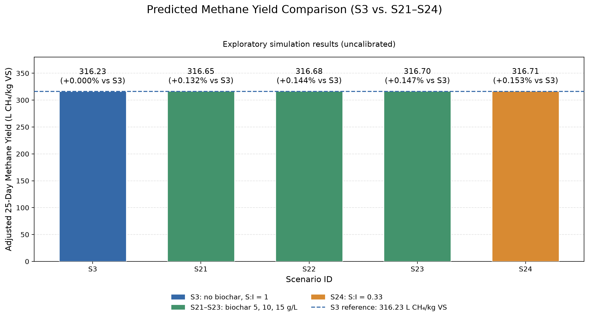
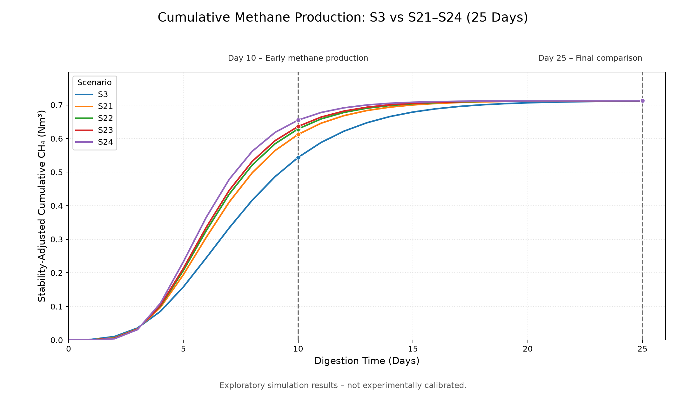
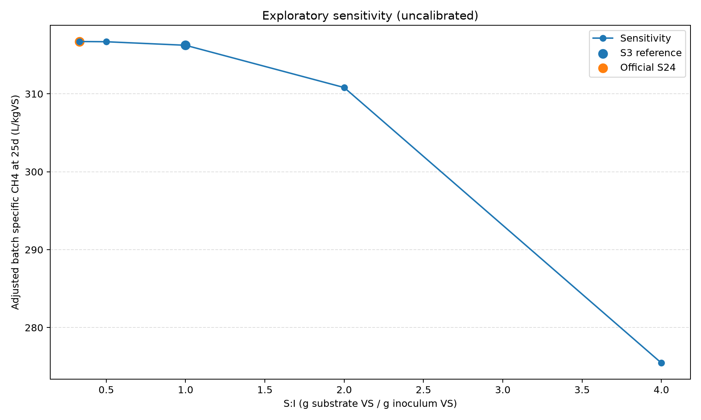

# Final Scenarios S21-S24: Biochar Addition and Inoculum Loading

27 October 2026 | Branch: `biochar-inoculum`

## Final decision

**Select S21 (5 g/L RHB550) as the first biochar condition to test. Select S24 (S:I = 0.33) as the inoculum-loading condition to test. Retain S3 as the reference.**

| Objective | Recommended scenario | Reason |
|---|---|---|
| First biochar experiment with lower material use | **S21: 5 g/L** | Nearly the same day-25 yield as the higher doses, using one-third of S23's biochar; the dose also has a relevant experimental literature anchor. |
| Highest calculated day-25 yield overall | **S24: S:I = 0.33** | Highest screening yield, 316.714 L CH4/kg VS, but requires 6.818 kg inoculum VS instead of S3's 2.250 kg. |
| Highest calculated yield among biochar cases | **S23: 15 g/L** | Produces 316.695 L CH4/kg VS, only 0.047 L/kg VS above S21. This small endpoint gain does not establish a reason to use three times the biochar. |
| Reference with no added biochar | **S3** | Essential comparator for determining whether either intervention provides a measured benefit. |

S22 is not the first priority for testing: doubling the biochar dose from S21 adds only about 0.036 L/kg VS to the day-25 screening yield. It remains useful as an intermediate dose when calibrating a full dose-response curve.

These recommendations select **experimental conditions**, not proven operating optima. S21-S24 are finalised as an exploratory, one-factor-at-a-time screening implementation. The response coefficients have not been experimentally calibrated, so the numerical ranking alone cannot establish which condition should be adopted in a real digester.

## Scenario parameters

| Scenario | Biochar (g/L) | S:I (g substrate VS/g inoculum VS) | Biochar mass (kg) | Inoculum VS (kg) |
| --- | --- | --- | --- | --- |
| S3 | 0 | 1 | 0.00 | 2.250 |
| S21 | 5 | 1 | 5.00 | 2.250 |
| S22 | 10 | 1 | 10.00 | 2.250 |
| S23 | 15 | 1 | 15.00 | 2.250 |
| S24 | 0 | 0.33 | 0.00 | 6.818 |

All masses in this comparison refer to the **same fixed substrate charge**, not continuous daily inoculum or biochar dosing. S3's S:I baseline of 1 is an explicit modelling assumption. Official S24 was changed from 2 to 0.33 following the formula-register recommendation; 2 remains an additional sensitivity case.

| Shared parameter | Value | Basis/status |
|---|---|---|
| Substrate | 100% baseline food waste; no SCG | Same composition in all five cases |
| Organic fractions | Carbohydrate 0.50; protein 0.25; lipid 0.20; inert 0.05 | Existing project composition |
| Wet substrate charge | 10 kg | Retained reference basis |
| Total solids fraction | 0.25 | 2.5 kg TS |
| VS/TS | 0.90 | **2.25 kg substrate VS** |
| Reactor working-volume basis | 1 m3 | Fixed; inoculum carrier liquid assumed adjusted |
| Fungal enzyme dose | 60 U/g VS | S3 reference |
| Fungal pretreatment | 24 h, 30 C, pH 5.5 | S3 reference; not digestion temperature |
| Batch observation window | 25 days | Same window for all cases; not a solved CSTR HRT balance |
| Biochar identity | Rice-husk biochar RHB550, pyrolysis at 550 C | Same assumed identity across S21-S23; batch properties uncharacterised |
| Nominal legacy OLR | 2.5 kg VS/m3/day | Retained metadata; actual legacy daily feed corresponds to 2.25 |
| Treated methane potential | 0.9683356212 Nm3/charge | Identical across all five cases |
| Composition theoretical methane ceiling | 1.202175 Nm3/charge | No added methane credited to biochar or inoculum |
| Fixed inherited lag | 3.279107 days | No additional biochar/inoculum lag reduction |
| Heuristic stability multiplier | 0.735935092 | Identical across all five cases; uncalibrated |

## Final model parameters and equations

| Parameter | Final setting | Scientific status |
|---|---|---|
| Biochar benefit coefficient, alpha_add | 0.5 | Unverified legacy assumption |
| Half-response concentration, K_add | 5 g/L | Unverified; not inferred from the 5 g/L experimental dose |
| Response exponent, n | 1 | Unverified shape assumption |
| High-dose inhibition | **Disabled by default** | No sufficiently matched inhibition evidence |
| Inhibition concentration, K_I,add | 30 g/L, inactive | Unverified optional sensitivity parameter |
| Inhibition exponent, m | 2, inactive | Unverified optional sensitivity parameter |
| Inoculum half-capacity, h | 1 | Unverified empirical capacity proxy |
| Empirical rate scale | 1 | Reference scaling; not a fitted ADM1 coefficient |
| Additional lag scaling | Removed | Not justified by Equations 84-86 or 89 |

The supplied register provides these relationships:

```text
Eq.84: R_add = C_add^n / (K_add^n + C_add^n)
Eq. 85: k_meth* = k_meth,0 * (1 + alpha_add*R_add) * I_add
Eq.86: I_add = 1 / (1 + (C_add/K_I,add)^m) [optional]
Eq.89: S:I = M_substrate,VS / M_inoculum,VS
       M_inoculum,VS = M_substrate,VS / (S:I)
```

C_add and K_add use the same g/L units; the response and inhibition factors are dimensionless. Equation 89 is a mass identity; it does not independently predict methane production.

**The S21-S24 route uses an empirical Gompertz approximation, not a mechanistic ADM1 methanogenic coefficient.** It uses the dimensionless Eq. 85 response structure as an explicitly exploratory multiplier on apparent conversion speed. It does not claim that the inherited hydrolysis descriptor is a measured k_meth. The separate dynamic ADM1 implementation is not modified by these scenarios.

The optional inoculum response is `f_I=(1+h)/(1+h*(S:I)/(S:I)_reference)`. This saturating proxy is an assumption, not Equation 89. The apparent rate is the inherited rate multiplied once by the biochar and inoculum factors; methane potential and inherited lag remain fixed. The Gompertz curve is origin-normalised to zero cumulative methane at day 0, and daily production is the difference between successive cumulative values.

## Implemented workflow

```text
S3 reference + one changed input (biochar OR S:I)
    -> dose-response / inoculum-mass calculation
    -> explicitly exploratory conversion-rate multiplier
    -> fixed-potential Gompertz curve over 25 days
    -> inherited heuristic stability adjustment
    -> specific yield per actual substrate VS, energy and comparison graphs
```

## Updated project outputs

| Scenario | Adjusted day-25 yield (L CH4/kg VS) | Change vs S3 | Unpenalised day-25 yield (L CH4/kg VS) | Adjusted cumulative CH4 (Nm3) | Apparent rate (1/day) |
| --- | --- | --- | --- | --- | --- |
| S3 | 316.230 | +0.000% | 429.699 | 0.711518 | 0.343462 |
| S21 | 316.649 | +0.132% | 430.267 | 0.712460 | 0.429327 |
| S22 | 316.684 | +0.144% | 430.315 | 0.712539 | 0.457949 |
| S23 | 316.695 | +0.147% | 430.330 | 0.712564 | 0.472260 |
| S24 | 316.714 | +0.153% | 430.356 | 0.712606 | 0.516484 |

The comparison metric is **stability-adjusted day-25 batch yield**, calculated as `1000 * adjusted cumulative methane / 2.25 kg substrate VS`. Percentage changes use the same metric and S3 denominator throughout.

The shared CSV also retains S3's historical specific-yield column of **285.053 L/kg VS**. That legacy daily-feed calculation uses the nominal OLR denominator of 2.5. It is not the same quantity as the new batch metric **316.230 L/kg VS**, which uses actual substrate VS and finite-time methane. Do not mix these two columns when comparing scenarios.

### Gross energy and methane volumes

| Scenario | Unpenalised cumulative CH4, day 25 (Nm3) | Gross methane energy (MJ/charge) | Gross electricity potential (MJ/charge) |
| --- | --- | --- | --- |
| S3 | 0.966822 | 34.612 | 12.114 |
| S21 | 0.968101 | 34.658 | 12.130 |
| S22 | 0.968210 | 34.662 | 12.132 |
| S23 | 0.968243 | 34.663 | 12.132 |
| S24 | 0.968300 | 34.665 | 12.133 |

Energy is based on **unpenalised** day-25 methane at 35.8 MJ/Nm3 and 35% electricity conversion efficiency. Values are MJ per substrate charge, not net energy or MJ/day. Biochar production, inoculum handling, pretreatment and reactor energy inputs are excluded; these small gross-energy differences do not establish economic benefit.

## Why the day-25 yield differences are small

S3 already reaches **99.844% of the fixed treated methane potential by day 25**. Changing conversion speed therefore has little methane remaining to recover at that endpoint. Earlier-time differences are larger:

| Scenario | Day-10 adjusted yield (L CH4/kg VS) | Day-25 adjusted yield (L CH4/kg VS) |
| --- | --- | --- |
| S3 | 241.702 | 316.230 |
| S21 | 272.128 | 316.649 |
| S22 | 279.452 | 316.684 |
| S23 | 282.680 | 316.695 |
| S24 | 291.067 | 316.714 |

The cumulative plot consequently shows changes in timing followed by convergence towards a common methane ceiling. This is consistent with the chosen model structure; it does not prove that biochar has only a small experimental effect. No direct yield boost, extra methane source or artificial improvement was introduced.

The deterministic outputs have no experimental replicate variability, so p-values are not appropriate. Small computed differences are not evidence of statistical significance. Parameter uncertainty may exceed the differences between biochar cases.

## Inoculum sensitivity

| S:I | Role | Adjusted day-25 yield (L CH4/kg VS) | Change vs S3 |
| --- | --- | --- | --- |
| 0.33 | Official S24 | 316.714 | +0.153% |
| 0.5 | Additional sensitivity | 316.684 | +0.144% |
| 1 | S3 reference | 316.230 | +0.000% |
| 2 | Additional sensitivity | 310.806 | -1.715% |
| 4 | Additional sensitivity | 275.457 | -12.894% |

Only 0.33 is official S24; the remaining non-reference ratios are supplementary sensitivity cases. The S:I = 2 result has changed from the earlier implementation because unsupported lag scaling was removed. All cases use the same substrate charge. Extra inoculum is not counted as an additional methane source, and inoculum activity/endogenous methane would need experimental characterisation.

## Output visualisations and data

The main folder is [output/s21_s24/](output/s21_s24/). The four main result files are:

1. [Scenario summary CSV](output/s21_s24/biochar_inoculum_summary.csv): exact numerical outputs behind this report.
2. [Combined methane-yield comparison](output/s21_s24/s21_s24_methane_yield_comparison.png): all five day-25 yields, percentage changes and S3 reference line.
3. [Cumulative methane curves](output/s21_s24/biochar_inoculum_gompertz_curve.png): stability-adjusted methane over time; most useful for interpreting kinetic differences.
4. [Inoculum-ratio sensitivity](output/s21_s24/inoculum_ratio_sensitivity.png): official S24 and additional S:I levels.







Detailed evidence remains in `output/s21_s24/supporting/`: parameter verification, literature comparison, parameter sensitivity, time-series CSVs and original snapshots. The parameter and validation sections of this document explain the main assumptions and evidence limits.

## Verification, literature comparison and validation status

- All 14 focused tests passed during finalisation. Checks cover Equations 84-86 and 89, units/bounds, S3 regression, OAT, methane/energy consistency, optional inhibition and reproducibility.
- S3 retains the recorded reference values. The larger review confirmed reproducible outputs and preservation of unrelated saved scenario results.
- **Ovi et al. (2022)** supports RHB550 and dose levels of 5, 10 and 15 g/L. The reported 5 g/L yield is 455.83 +/- 17.9 versus control 333.32 +/- 14.9 mL CH4/g VS_added. These observations are not fitted to this fungal-treated charge, and differences in substrate/inoculum, operating conditions, gas reference basis and duration limit direct comparison.
- **Kawai et al. (2014)** tested VS-based ratios of 0.33, 0.5, 1, 2 and 4 and reported an ultimate yield of 435 mL CH4/g VS at S:I = 0.33 for standard food waste. This supports the scenario anchor, not a universal optimum or the assumed capacity coefficient.
- **Rocha et al. (2024)** informs BMP characterisation and full-curve/residual-based calibration methodology. Its sewage-sludge data do not independently validate food-waste predictions.
- **Zaferanloo et al. (2026)** explicitly describes a literature-informed scenario-screening framework with no new experimental calibration; its results are context, not independent validation of these assumptions.
- No sufficiently matched experimental dataset was available for MAE/RMSE or confidence intervals. Current outputs are **uncalibrated model-derived screening estimates**, not experimentally established yields.

The separate repository-wide test suite previously failed during import because the committed dynamic ADM1 tests expect configuration names such as ENZYME_DOSES that are absent from data.config. This pre-existing issue does not invalidate the executed focused mathematical checks, but repository-wide verification remains incomplete.

## Final recommendations

### 1. Use S21 as the first biochar test condition

Start with **5 g/L RHB550**, keeping the S3 feedstock, pretreatment, substrate mass, working volume and S:I baseline unchanged. S21 gives **316.649 L CH4/kg VS**, a **0.132%** increase over S3 in the day-25 model output. It requires 5 kg biochar on the 1 m3 working-volume basis, compared with 10 kg for S22 and 15 kg for S23.

This is the preferred lower-dose experimental candidate because the higher doses provide very little additional day-25 yield under the current assumptions. It is not a demonstrated economic optimum. Measure both early methane production and final yield before deciding whether to increase the dose.

### 2. Use S24 to test the benefit of increased inoculum

Use **S:I = 0.33 g substrate VS/g inoculum VS** as the official inoculum experiment. S24 has the highest calculated yield, **316.714 L CH4/kg VS**, or **0.153% above S3**. Keep S:I = 2 as an additional sensitivity condition rather than replacing the official definition.

For the 2.25 kg substrate VS charge, S24 requires **6.818 kg inoculum VS**, approximately three times S3's 2.250 kg. Its small day-25 gain does not by itself justify this extra inoculum. Assess start-up speed, inoculum activity, availability and handling requirements before recommending operational use.

### 3. Do not prioritise S23 solely because it ranks highest among biochar cases

S23 produces **316.695 L CH4/kg VS**, but exceeds S21 by only **0.047 L/kg VS** while using three times the biochar. Keep S23 as a higher-dose comparison for calibration or for testing whether earlier methane recovery improves materially. The current model does not show that its additional material use is worthwhile.

S22 is a useful intermediate calibration point, rather than the preferred initial condition. Neither the differences between S21-S23 nor their ordering should be described as statistically significant.

### 4. Make the next decision using measured kinetics and resource use

Retain S3 as the reference and compare independent replicate experiments for S3, S21 and S24. Record methane versus time, time to reach 50% and 90% of measured methane potential, final yield, pH, VFAs and inoculum activity. Include inoculum blanks and consistent gas/VS normalisation. Include S22 and S23 when a full biochar dose-response calibration is feasible.

Fit the response coefficients to the calibration data, then evaluate performance on separate observations. Include biochar production, inoculum handling and pretreatment energy/cost before selecting a practical operating condition. A recommendation for full-scale use cannot be made from these uncalibrated endpoint differences alone.

**Recommended next step: test S21 for lower-dose biochar addition and S24 for inoculum loading against S3. S24 is the numerical overall leader; S23 is the numerical biochar leader. Neither is yet a validated process optimum.**

## How to reproduce

```powershell
python -B main.py --biochar-only
python -B -m unittest discover -s tests -p test_biochar_inoculum.py -v
```

Main implementation files: `AD/biochar_inoculum.py`, `data/biochar_config.py`, `utils/biochar_visualisations.py`, `utils/biochar_verification.py`, `tests/test_biochar_inoculum.py`; integration in `main.py`, mass calculation in `AD/feedstock.py`, and historical-reference compatibility in `pretreatment/screening_reference.py`.

## References

1. Ovi, D.; Chang, S.W.; Wong, J.W.C.; et al. (2022). Effect of rice husk and palm tree-based biochar addition on the anaerobic digestion of food waste/sludge. *Fuel*, 315, 123188. https://doi.org/10.1016/j.fuel.2022.123188
2. Kawai, M.; Nagao, N.; Tajima, N.; Niwa, C.; Matsuyama, T.; Toda, T. (2014). The effect of the labile organic fraction in food waste and the substrate/inoculum ratio on anaerobic digestion for a reliable methane yield. *Bioresource Technology*, 157, 174-180. https://doi.org/10.1016/j.biortech.2014.01.018
3. Rocha, M.E.; Lazarino, T.C.; Oliveira, G.; et al. (2024). Analysis of biogas production from sewage sludge combining BMP experimental assays and the ADM1 model. *PeerJ*, 12, e16720. https://doi.org/10.7717/peerj.16720
4. Zaferanloo, P.; Hossain, M.I.; Maehara, S.; Ektesabi, M.; Malherbe, F.; Zaferanloo, B. (2026). Fungal Pretreatment-Assisted Methane Recovery from Food Waste: A Literature-Informed Simulation Framework. *Molecules*, 31, 3594. https://doi.org/10.3390/molecules31203594
5. *Complete Formula Notation Scenario Literature Data - 6102026.pdf*, supplied working register: p. 20, Equations 84-86; p. 22, Equation 89; pp. 24-25 scenario/literature anchors.
6. *Bita feedback after our meeting in week 9.pdf*, supplied working report, updated 8 October 2026: OAT principles, S3 baseline requirements and Section 6, p. 5 biochar/inoculum literature anchors.

Reference values above come from the supplied documents and the earlier source audit. They are not presented as new measurements or fitted coefficients.

## Recorded verification result

```text
----------------------------------------------------------------------
Ran 14 tests in 0.058s

OK
```
